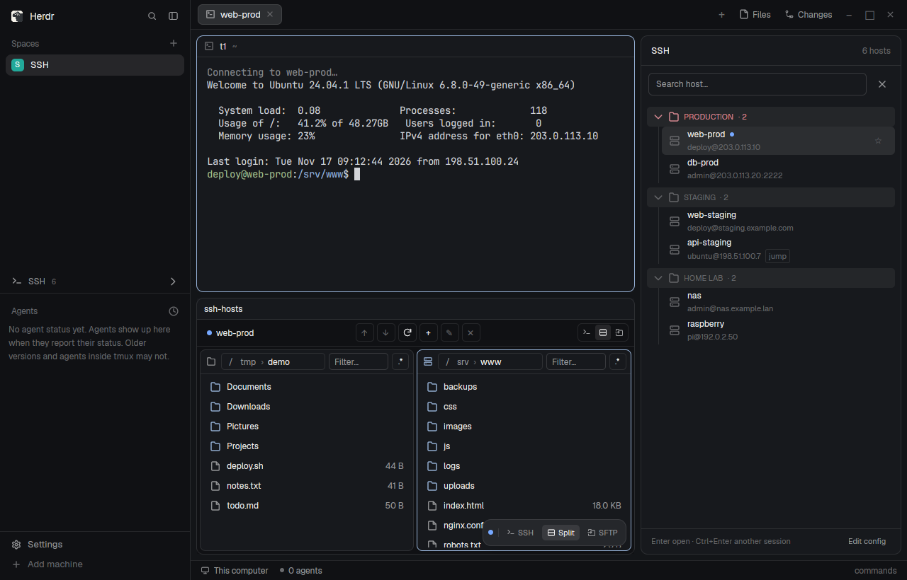

# herdr-ssh-hosts

A mod for [Herdr](https://herdr.dev) (herdr-app): an **SSH host picker** and, for each host, one tab with the **SSH terminal** on top and a two-pane **SFTP browser** below (this computer and the server, FileZilla style), signed in **once** for both.

- **Picker:** the aliases in `~/.ssh/config` with search, `user@host:port`, pinned and recent hosts, groups taken from the file's comments, and a marker for open sessions. Opens with **Ctrl+Shift+H**, from an optional sidebar row, or from a button in your own tab bar.
- **One tab per host:** split view by default, SSH on top with the keyboard. Choosing a host that is already open goes back to its tab; **Ctrl+Enter** opens another session without signing in again.
- **SSH / Split / SFTP** in one click, from the SFTP toolbar or an optional floating pill that also shows the SFTP status. The pane you hide keeps running.
- **One sign-in:** a password, passphrase or new fingerprint is asked once, in a centered dialog, and serves SSH and SFTP.
- **Browser:**
  - One toolbar (status, summary, actions, mode) and one header row per pane (path, filter, hidden files). No footers.
  - Multi-selection, keyboard shortcuts and a context menu.
  - A transfer queue with whole folders, progress and conflicts (skip, rename or overwrite), shown only while there are transfers.
  - A read-only viewer for text files on the server (F3).



The screenshot uses invented servers. Full documentation is in [`mods/ssh-hosts/README.md`](mods/ssh-hosts/README.md); [`RECIPE.md`](RECIPE.md) is the brief another agent can build the mod from with an empty folder.

## Requirements

- Herdr (herdr-app).
- OpenSSH (`ssh`) on the PATH and a `~/.ssh/config` with your hosts.
- Python 3, standard library only, for the browser and the SSH terminal's sign-in wait. On Windows the mod calls it as `python`; on Linux and macOS, as `python3`.

It installs no packages or services and never writes a password to disk. On Linux and macOS the shared sign-in is an OpenSSH ControlMaster and nothing is kept. Windows' OpenSSH has no ControlMaster, so there the password typed in the dialog stays **in memory** only until the terminal uses it: handed over once, and forgotten after 2 minutes at most. A second session of a host asks again on Windows.

## Install

First read `~/.config/herdr-app/AGENTS.md`: Herdr rewrites it with the rules of its version.

```sh
git clone https://github.com/thebends2k/herdr-ssh-hosts.git
cp -R herdr-ssh-hosts/mods/ssh-hosts ~/.config/herdr-app/mods/
herdr-app check ~/.config/herdr-app/mods/ssh-hosts
```

`herdr-app check` needs the folder path. If `~/.config/herdr-app/mods/ssh-hosts` already exists, look at what it holds before replacing it.

Then merge [`keys.json`](keys.json) into `~/.config/herdr-app/keys.json` (ask before replacing a key already in use):

```json
{ "global": { "ctrl-shift-h": "mod.open:ssh-hosts" } }
```

That is all it needs: **Ctrl+Shift+H** opens the picker, and every host tab carries its own SSH / Split / SFTP switch. No layout changes are required.

## Optional: in a layout of your own

Herdr's shipped layouts are read-only, so clone one first: `herdr-app do layout.clone '{"name":"main","as":"my-layout"}'`.

- **SSH row** in the sidebar (for example under Spaces), with the number of hosts:

  ```json
  { "id": "ssh-hosts", "type": "block", "content": { "mod": "ssh-hosts" }, "size": { "px": 32 }, "min": 32, "max": 32 }
  ```

- **Floating pill** (status + SSH / Split / SFTP), on the block that shows the tab (`"tab": "active"`). It only draws on host tabs and can be dragged:

  ```json
  "floating": [
    { "id": "ssh-bar", "content": { "mod": "ssh-hosts", "props": { "bar": true } }, "edge": "bottom", "align": "end" }
  ]
  ```

- **Button in a tab bar mod of your own** (a clone of `tabs`), for example before Files:

  ```js
  openOverlay({ mod: "ssh-hosts", props: { popup: true, height: shared("ssh-hosts.popupHeight") ?? 420 },
                kind: "popup", width: 360, height: shared("ssh-hosts.popupHeight") ?? 420 });
  ```

  `shared("ssh-hosts.sessions")` maps the host tabs' ids to `{ alias, target }`, to mark the button while one is shown.
