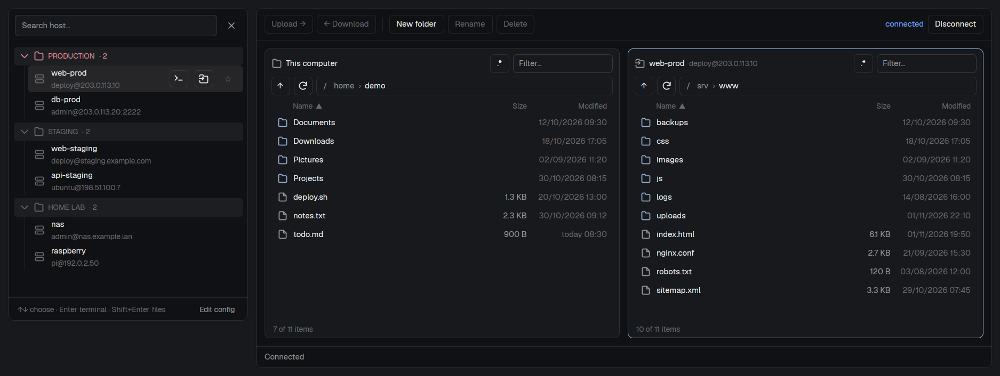

# herdr-ssh-hosts

A mod for [Herdr](https://herdr.dev) (herdr-app): an **SSH host picker** in the sidebar and a **two-pane SFTP browser** (this computer and the server), FileZilla style.

- **Picker:** the aliases in `~/.ssh/config` with search, `user@host:port`, pinned and recent hosts, groups taken from the file's comments, and a marker for open sessions. Each host opens an SSH terminal or the file browser.
- **Browser:**
  - Two panes with multi-selection, keyboard shortcuts and a context menu.
  - A transfer queue with whole folders, progress and conflicts (skip, rename or overwrite).
  - A read-only viewer for text files on the server (F3).
  - Passwords and fingerprints in a dialog of its own, the same on Linux, macOS and Windows.



The screenshot uses invented servers. Full documentation is in [`mods/ssh-hosts/README.md`](mods/ssh-hosts/README.md); [`RECIPE.md`](RECIPE.md) is the brief another agent can build the mod from with an empty folder.

## Requirements

- Herdr (herdr-app).
- OpenSSH (`ssh`) on the PATH and a `~/.ssh/config` with your hosts.
- Python 3, standard library only, for the browser. On Windows the mod calls it as `python`; on Linux and macOS, as `python3`.

It installs no packages or services, and it never stores passwords.

## Install

First read `~/.config/herdr-app/AGENTS.md`: Herdr rewrites it with the rules of its version.

```sh
git clone https://github.com/thebends2k/herdr-ssh-hosts.git
cp -R herdr-ssh-hosts/mods/ssh-hosts ~/.config/herdr-app/mods/
herdr-app check ~/.config/herdr-app/mods/ssh-hosts
```

`herdr-app check` needs the folder path. If `~/.config/herdr-app/mods/ssh-hosts` already exists, look at what it holds before replacing it.

## Add it to a layout

`mod.json` uses `place: none`: copying the mod adds nothing to the window. The picker is a 32 px block in the sidebar of a layout of your own. Herdr's shipped layouts are read-only, so clone one first: `herdr-app do layout.clone '{"name":"main","as":"my-layout"}'`. Then add this block wherever you want the **SSH** row (for example, under Spaces):

```json
{ "id": "ssh-hosts", "type": "block", "content": { "mod": "ssh-hosts" }, "size": { "px": 32 }, "min": 32, "max": 32 }
```

The SFTP browser needs no block: it opens as a tab from the picker.
