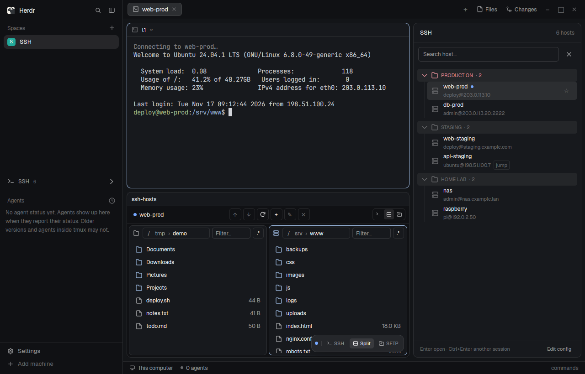

# SSH hosts

An **SSH** host picker (Ctrl+Shift+H, a sidebar row, or a button in a tab bar of your own) that opens a searchable list of the hosts in your `~/.ssh/config`, grouped by the comments in that file. Choosing a host opens one tab in **split view**: the SSH terminal on top and a two-pane FileZilla-style **SFTP browser** below. A password, passphrase or new fingerprint is asked **once**, in a centered dialog, for both. **SSH / Split / SFTP** switch in one click from the SFTP toolbar or an optional floating pill, keeping the hidden pane alive.



## What you see

**The sidebar row** (optional). A block 32 px high (fixed: `min` and `max` are 32 too) with, left to right: a terminal icon, the word `SSH`, the number of hosts (10 px, dimmed, filling the free space), and a right chevron. When the row is narrower than 120 px (a collapsed sidebar) it shows only the centered terminal icon, with an `SSH hosts (Ctrl+Shift+H)` tooltip. Text is 12 px, on the theme's `chrome` background; on hover the background becomes `hover` and the text `foreground`.

**The picker popup.** 360 px wide. **As a side panel** (a block `{mod: 'ssh-hosts', props: {panel: true}}` in the layout, e.g. a child of the right panel's stack like Files): the same search, list and footer in a card that fills the block (rounded 10, `background`, border), under a 42 px header with `SSH` and the host count. Whenever the shown layout holds that block, `mod.open`, the row and the buttons show it instead of the popup: each stack on the way selects its child first, then hidden nodes are shown, then `ssh-hosts.focusPanel` is bumped so the search box takes the keyboard (it also does whenever the panel becomes visible). `mod.open`'s overlay closes at once. It stays open while hosts are opened; Esc or × hides the nearest sized node holding it (`layout.hide`). Without such a block nothing changes. As a popup, opened from the row or a tab bar button its height fits its content, never less than 220 px or more than 560 px; opened with `mod.open` it is 420 px, near the top of the window (the `overlay` of `mod.json`). Top to bottom:

1. A 52 px bar: a search field (32 px high, placeholder `Search host…`, the cursor already in it) and a 32 px square close button.
2. The list, which scrolls. Sections in this order: **Pinned**, **Recent** (only when there are more than 6 hosts), then one section per group of the file. A group header is 28 px: chevron, folder icon, the name in capitals, ` · N`, on a shaded (`hover`) background; 11 px text, dimmed, **red (`ansi1`) if the name contains "prod"**. Its hosts are indented 16 px with a 1 px vertical line on the left. Pinned and Recent have a plain heading with no icons or fold.
3. Each host row is 40 px: a server icon, the alias, and under it `user@host:port` in 11 px dimmed text (port 22 is not shown). A small `jump` tag with a border appears when the host has `ProxyJump`. A 6 px round green (`done`) dot beside the alias means its tab is open. A pinned host shows a ★ on the right.
4. A 36 px footer with a 1 px top border: `Enter open · Ctrl+Enter another session` on the left and an `Edit config` button on the right.

The hovered or chosen row has the `selected` background and a ☆ to pin on the right (★ in the accent color once pinned).

**A host's tab**, named `<alias>`: the SSH terminal on top, with the keyboard, and the SFTP pane below at the same height. The SFTP pane, top to bottom:

1. **One 38 px toolbar.** Left: the status (a 7 px dot: `done` when connected, `blocked` while a dialog or a conflict waits, `ansi1` on error, `dim` when closed; a braille spinner while connecting) and the alias in semibold, plus `user@host:port` dimmed when wider than 900 px; a click disconnects or reconnects. Then, wider than 560 px, ` · ` and an 11 px summary: an error's first line in `ansi1` (with an × to hide it; the full text in its tooltip), else the last message, else the selection (`N selected · size`, or the cursor's name and size). Centered between flexible gaps: 26 px square buttons `↑` upload, `↓` download, refresh icon, `+` new folder, `✎` rename, `✕` delete (in `ansi1`), each with its key in the tooltip. Right: the **SSH | Split | SFTP** switch, three 22 px segments in a 1 px bordered group with icons (`terminal`, `split`, `sftp`) and labels (icons only below 700 px); the current one on `selected`.
2. **Two panes side by side**, each with **one 34 px header row**: the side's icon (`folder` for Local, `server` for the host; accent when it is the active pane) and its name when wider than 420 px, the breadcrumb path bar, a name filter (120 px, 84 px when narrow) and a `.*` toggle. Then a virtual list of 28 px rows: icon, name, size, modified date (wider than 360 px) and permissions (server, wider than 560 px). No column header row and no footer.
3. **The transfer queue**, only while there are transfers: a 30 px strip with a chevron, the running file (`↑ name · 42%`) or `Preparing folders…` or `Done: …`, `N queued`, a 5 px progress bar, speed and time left, and `Cancel all` / `Retry` / `Clear` as they apply. A click unfolds one 24 px row per job (folded by default, remembered). When everything finished without problems it clears itself 3 s later.
4. Dialogs over a near-opaque canvas (97 %), 440 px wide cards: name conflict, new folder, rename, delete, and the read-only file viewer.

If the layout's pane header is drawn over the pane (`reveal: "hover"`, at the top), an empty strip of the header's height comes first, so the header never covers the toolbar — unless the header mod's name is in `shared("ssh-hosts.clearHeaders")`.

**The sign-in dialog** (`props.auth`), centered over the window, dimming it, modal, 440 px: a server icon and the title (`Password`, `Key passphrase`, `Verify the server`, or `OpenSSH`), under it `alias · user@host:port · SSH and SFTP share this sign-in` in 11 px dim, OpenSSH's question in the terminal font, then a masked field with `Sent only to OpenSSH; never written to disk.` and `Cancel` / `Connect`; or, for a fingerprint, an explanation and `Reject` / `Trust and connect`. After a refused password it adds `Not accepted. Try again.` in `ansi1`.

**The floating pill** (`props.bar`, optional) over the tab block, `edge: "bottom", align: "end"`. It renders nothing (`div()`) unless the focused tab is a host tab. On one it draws a 26 px bar: the status (the same dot or spinner, or `↑ 42%` / `↓ 42%` while transferring, with the state in its tooltip), a 1 px separator, and the three segments. Dragged to a side edge it stacks them vertically, icons only.

All colors come from the active theme (`chrome`, `hover`, `selected`, `border`, `foreground`, `muted`, `dim`, `accent`, `done`, `blocked`, `ansi1`, `popover`, `canvas`, `input`, `solid`); nothing is hard-coded except the transparent `#00000000`.

## How it behaves

**Reading the hosts.** Only the explicit aliases of `~/.ssh/config` are listed (patterns such as `*` and `Include` files are not). A comment right above a `Host` line, with no blank line between, starts a group named after it (up to 40 characters) that lasts until the next such comment; a comment followed by a blank line (a file header) is not a group. Without any group there are no headings; with groups, hosts outside them go last under `Other`. User, port and ProxyJump shown come from the host's block, falling back to `Host *`; the first value wins, as in OpenSSH. The list reloads by itself when the file changes (a 30 s timer if the folder cannot be watched). If the file is missing the popup says `~/.ssh/config not found` in red; with no hosts, `No aliases in ~/.ssh/config. Add a “Host” block and it will show up here.`; with no match, `No host matches “…”`.

**Picker keys and clicks.** Typing filters by alias, host, user or group and shows every match in one list. ↑ ↓ move the cursor (wrapping); hovering a row moves it too. `Enter` or a click opens the host's tab, or selects it if one is open (a tab remembered in `ssh-hosts.sessions`, or named after the alias); `Ctrl+Enter` or `Ctrl+click` always opens another. `Esc` or the X closes. Clicking a group header folds it (remembered). The ☆ pins a host. The last 8 hosts used are remembered. Pinned, recent, folded groups, the host tabs (`ssh-hosts.sessions`: tab id → `{alias, target}`), the popup height (`ssh-hosts.popupHeight`) and the SFTP panes' status (`ssh-hosts.sftp.live`: tab id → `{alias, status, pct, dir}`) live in Herdr's shared state. `Edit config` opens the file with `xdg-open` (Linux), `open -t` (macOS) or `notepad.exe` (Windows).

**Opening a host.** `tab.new` in the active local space (else the space named `SSH`, else the first local one; with none, `space.new` named `SSH`) with the terminal running `python3 sftp_bridge.py shell <alias> <config>`. Once its pane exists, the tab is recorded in `ssh-hosts.sessions`, `pane.split { direction: 'down', mod: 'ssh-hosts', props: { mode: 'sftp', alias, target, tab } }` adds the SFTP pane, and `pane.focus` gives the terminal the keyboard back.

**SSH / Split / SFTP** (`session.js`, shared by the toolbar switch and the pill). SSH: `pane.zoom` on the terminal (or `pane.focus` if it already is). Split: undo the zoom. SFTP: `pane.zoom` on the SFTP pane. Zooming one pane while the other is zoomed moves the zoom. If the pane asked for was closed, it is split back in (`pane.split` down from the other, then `pane.swap` so SSH stays on top) and zoomed or focused.

**One sign-in.** The SFTP pane's helper starts ssh with `SSH_ASKPASS` pointing at `askpass.sh` / `askpass.cmd`. A question reaches the pane as `state.prompt`; the pane opens the dialog with `openOverlay({ mod: 'ssh-hosts', kind: 'dialog', modal: true, width: 440, props: { auth: { url, token, prompt, retry, alias, target } } })`, which posts `{action: 'answer', id, value}` to the helper and closes. Closing it any other way (Esc) answers `null`, which refuses. A new or vanished prompt closes the old dialog.
- Linux and macOS: every ssh of the mod adds `-o ControlMaster=auto -o ControlPath=<runtime>/cm-%C -o ControlPersist=120`, `<runtime>` being `$XDG_RUNTIME_DIR/herdr-ssh` or `/tmp/herdr-ssh-<uid>` (mode 0700, owner checked; short, since a socket path has ~100 bytes). The first ssh to connect becomes the master; the rest ask nothing.
- Windows: no ControlMaster. The helper remembers what was typed for each secret prompt, keeps it only once the connection worked, and answers a prompt flagged `replay` with it **once** (then drops it); it is also dropped after 120 s (purged on the heartbeat, not only when asked), on failure and on close. On Windows ssh always gets `-o KbdInteractiveAuthentication=no`: `askpass.cmd` goes through `cmd.exe`, so only OpenSSH's own prompts may reach it. The runtime folder there is `%LOCALAPPDATA%\herdr-ssh`, and `shell` only replays to a session file whose url is `http://127.0.0.1:<port>`. A second session or a reopened terminal asks again in the dialog.
- The helper writes `<runtime>/<alias>.json` (`{state: connecting|ready|failed, url, token, pid, beat}`, mode 0600, atomically) on each change and every 2 s, and deletes it on close if it is still its own. A file whose beat is older than 7 s is ignored.
- `shell` prints `Connecting to <alias>…`, then loops every 0.3 s: master alive (`ssh -O check`) or state `ready` → go; `failed` → say so and go; no file after 4 s → go; Enter → go; at most 10 minutes. On the first live file it adds a line about the dialog and Enter. Then it `exec`s `ssh -F <config> <mux options> <alias>`; on Windows, with a `ready` state, it runs ssh with `SSH_ASKPASS_REQUIRE=force`, `HERDR_SFTP_REPLAY=1` and the helper's url and token, and exits with its code. If anything fails, plain `ssh -F <config> <alias>`.

**The SFTP browser.**
- Click selects and makes that pane active; `Ctrl+click` toggles; `Shift+click` selects a range; double-click opens a folder or sends a file to the other pane. Keyboard with a list focused: ↑ ↓ PageUp PageDown Home End move (with `Shift`, select); `Enter` opens or sends; `Backspace` goes to the parent and keeps the cursor on the folder you left; `Tab` switches pane; `F3` views a server file; `F5` sends; `F2` rename; `F7` new folder; `Del` delete; `Ctrl+A` select all; `Ctrl+C` copy the paths; `Ctrl+F` filter; `Ctrl+R` refresh; `Ctrl+H` hidden files; `Esc` clears the filter, then the selection, or cancels a dialog. In dialogs `Enter` confirms.
- Right-click opens a menu (view, transfer, rename, delete, new folder, copy paths, refresh, show or hide hidden files, and `Sort by name / size / modified` with a ✓ and ▲▼ on the current one). Files and folders can be dragged from the system onto the server pane.
- Sorting by name uses natural order (`file2` before `file10`). Each pane remembers its sort and hidden-files setting; the last local and remote folder are remembered per host. On Windows the local pane starts at `Computer` with the drives.
- Transfers go through the queue; folders are walked while transferring, so queuing a huge folder is instant. Statuses and their labels: `queued` → `Queued`, `running` → `Transferring`, `conflict` → `Already exists: waiting`, `done` → `Done`, `skipped` → `Skipped`, `failed` → `Failed`, `cancelled` → `Cancelled`. When a file already exists the queue stops and shows size and date of both, with `Skip`, `Rename` (saves as `name (2).ext`) and `Overwrite`, and an option to apply it to the rest. An overwritten server file keeps its permissions; a new one gets `rw-r--r--`. Folders that exist are completed without asking. Links to folders are not followed (on Windows, directory junctions and other name-surrogate reparse points count as links); links to files are transferred as files. You can keep browsing while it transfers.
- Delete asks first and only removes a file, a link or an **empty** folder. Rename never replaces an existing file.
- The viewer (`F3`) shows a text file from the server read-only with syntax highlighting. Files over 1 MB, binary files and folders are refused with a message.

**Agent statuses.** The mod does not read or show agent statuses (working, blocked, done, idle); the only statuses it draws are its own (open host, SFTP connection).

## Built from

Folder `mods/ssh-hosts/`, which is the whole mod, plus `keys.json` at the repository root:

| File | Role |
|---|---|
| `mod.json` | `{"place":"none","title":"SSH","overlay":{"kind":"popup","at":"top","offset":40,"width":360,"height":420}}`. `place: none`: copying the folder adds nothing to the window; `overlay` is how `mod.open ssh-hosts` shows the picker. |
| `main.js` | `SSHHosts` view, by props: the SFTP pane (`mode: 'sftp'`), the sign-in dialog (`auth`), the pill (`bar`), the picker (`popup`, or any overlay without those; `panel` in a layout block), else the sidebar row. |
| `session.js` | Host tabs: `shellArgv`, `sessions`, `rememberSession`, `tabState` (panes and mode of a tab), `liveStatus`, `setMode`; the optional side panel (`panelPath`, `panelShown`, `showPanel`, `hidePanel`, `togglePanel`); paths of the config, the helper and Python. |
| `config.js` | Parses `~/.ssh/config`: `parseConfig`, `groupHosts`, `target`, `launchPlan(alias, argv, spaces)`. |
| `sftp.js` | `SftpPanel`: the whole SFTP view; publishes its status and opens the sign-in dialog. |
| `sftp_bridge.py` | Python 3 helper (standard library only): `start` / `serve` (the SFTP connection, local listings, transfers, the loopback HTTP API, the session file) and `shell` (the terminal's wait and ssh). |
| `askpass.sh`, `askpass.cmd`, `askpass.py` | `SSH_ASKPASS` programs that hand OpenSSH's questions to the helper (`replay` when `HERDR_SFTP_REPLAY=1`). |
| `*.svg` | 16 px icons, drawn with `svg('mods/ssh-hosts/<name>.svg')`: `terminal`, `server`, `sftp`, `split`, `folder`, `file`, `chevron-down`, `chevron-right`, `close`, `refresh`. |
| `jsconfig.json`, `README.md` | Editor settings and the mod's documentation. |
| `keys.json` (repository root) | `{"global": {"ctrl-shift-h": "mod.open:ssh-hosts"}}`, to merge into the person's. |

**Layout.** None is needed: the key opens the picker and the switch lives in the SFTP toolbar. That switch is hidden in the SSH view, so the README must say how to come back (the pill, the pane header's unzoom button, or `pane.zoom`, Ctrl+Shift+Z by default) and recommend the pill. Optional, in a cloned layout (`herdr-app do layout.clone '{"name":"main","as":"my-layout"}'`): the row `{ "id": "ssh-hosts", "type": "block", "content": { "mod": "ssh-hosts" }, "size": { "px": 32 }, "min": 32, "max": 32 }`, and the pill on the tab block (the one whose `content` is `{ "tab": "active" }`; `floating` goes next to `content`, added to any list already there):

```json
"floating": [
  { "id": "ssh-bar", "content": { "mod": "ssh-hosts", "props": { "bar": true } }, "edge": "bottom", "align": "end" }
]
```

A tab bar mod of your own can open the picker with the popup call below and mark its button while `shared("ssh-hosts.sessions")` has the shown tab.

**Imports.** From `gpui-kit`: `View`, `div`, `svg`. From `gpui-base`: `v_flex`, `h_flex`, `Input`, `InputState`, `Editor`, `EditorState`, `Scrollbar`, `v_virtual_list`, `VirtualListScrollHandle`. From `herdr`: `appHome`, `checking`, `closeOverlay`, `exec`, `focused`, `home`, `layout`, `openOverlay`, `panes`, `placement`, `props`, `readTextFile`, `run`, `setShared`, `settings`, `shared`, `spaces`, `theme`, `watchFolder`, `window`.

**Commands it runs:** `tab.new` (`{space, name, argv}`), `space.new` (`{machine: '', name: 'SSH', tab: alias, argv}`), `pane.split` (the SFTP pane, or a terminal with `argv`), `pane.zoom`, `pane.focus`, `pane.swap`, `space.select`, `tab.select`. The popup is `openOverlay({ mod: 'ssh-hosts', props: { popup: true, height }, kind: 'popup', width: 360, height })`.

**Programs it runs:** `ssh` (OpenSSH, on the PATH) and `python3` (`python` on Windows). The helper starts `ssh [-F <config>] -T [-o StrictHostKeyChecking=ask] -o ConnectTimeout=20 -o ServerAliveInterval=15 -o ServerAliveCountMax=3 -o ForwardAgent=no -o ClearAllForwardings=yes -o PermitLocalCommand=no <mux options> -s <alias> sftp`, with `SSH_ASKPASS` and `SSH_ASKPASS_REQUIRE=force`. Host-key checking is never turned off. `-F` is passed only when the config is not `~/.ssh/config` (with `-F` OpenSSH skips `/etc/ssh/ssh_config`). `StrictHostKeyChecking=ask` is left out when `ssh -G` says the person's config already has `yes`. Python is always started with `-I`. The view calls `exec(python, [helper, 'start', alias, config, start])` and then talks to it with `fetch` over HTTP on `127.0.0.1` (random port, random key): `POST /rpc` runs an action and a long-poll on `/events` delivers progress and listings with no timers. `shell` runs `ssh -O check` and then `ssh`. `xdg-open`, `open` or `notepad.exe` open the config.

**Files it touches outside its folder:** reads `~/.ssh/config`; writes the master sockets and `<alias>.json` session files in `<runtime>` (private to the user); the SFTP browser reads and writes any local folder the person browses; transfers create `.herdr-upload-*` and `.herdr-download-*` temporaries next to their targets. It reaches the network only through `ssh`, to the servers the person picks.

## Watch out

- **`place: none` is deliberate.** Do not edit a shipped layout; it is replaced on every start. Everything works without layout changes; the row and the pill are extras.
- **A popup takes its content's size.** A list with only a flexible height collapses, so the height is passed in `props` (or set by `mod.json`'s `overlay` for `mod.open`).
- **Hosts are informational.** User, port and jump shown are read by `config.js`; OpenSSH resolves the real connection. `Include` files, `Match` blocks and wildcard aliases are not listed. A `Host` with several aliases lists each one. Aliases must match `^[a-zA-Z0-9][a-zA-Z0-9._-]*$`; anything else is skipped (this also keeps the alias safe as an argument and as a file name).
- **Group names** are comments directly above `Host` (no blank line) and at most 40 characters; a longer one is ignored. A group with "prod" in its name is red, any case.
- **Limits:** 20,000 entries per folder listing, the viewer reads up to 1 MB, 64 requests of 32 KB in flight per transfer (like OpenSSH's `sftp`), the recent list keeps 8 hosts and shows 4, the master lives 120 s after its last session. The helper exits on disconnect, when the pane closes, or after 90 s without the pane; a forced close or a lost connection can leave an unfinished `.herdr-upload-*` or `.herdr-download-*` behind.
- **Never write or log a password.** It goes from the masked field to OpenSSH through the askpass program, never into a file, an argument or the shared state. The only copy kept is Windows' in-memory, one-shot, 120 s one described above. The session file holds the helper's url and token, so it is 0600 in a 0700 folder.
- **ControlMaster and the helper's options.** When the SFTP pane's ssh is the master, its `ForwardAgent=no` and `ClearAllForwardings=yes` are the master's; the terminal's own forwardings are requested by the terminal's ssh through it.
- **Server names are hostile until checked.** Every name written on this computer goes through `local_child(folder, name)`: `safe_name` (no `/`, `\`, `..`, NUL, line breaks), and on Windows no `:`, device names (`CON`, `NUL`, `COM0-9`, `LPT0-9`, `COM¹²³`, `LPT¹²³`, any extension), trailing dot or space, or `<>"|?*`; and the joined path's parent must be the folder. A folder's children that fail are queued as skipped with the reason.
- **Hostile servers and hostile trees.** Prompts are classified strictly: only `Enter passphrase for key '…` is a passphrase and only `The authenticity of host '…` / `Warning: the … host key for '…` is a fingerprint question; anything prefixed `(user@host) ` is the server's own text, shown as "<alias> asks". A download stops when a DATA reply is longer than asked, and the viewer's download stops at its 1 MB limit whatever the server claimed. A folder transfer stops at 64 levels or 100 000 queued items. Uploading a folder never follows a link inside it (skipped, "Link: not followed", and opened with `O_NOFOLLOW`); on Windows a junction is a link too, though `os.path.islink()` says no. When each job inside a folder runs, the real path of its local folder must still be the chosen folder plus the names in between, so a folder swapped for a link after queuing is refused ("A folder on the way is now a link: not followed").
- **The loopback server.** Requests without the right token are answered 403 and the connection closed; only authenticated requests keep the helper alive; a connection idle for 30 s is dropped and at most 32 are served at once.
- **State lives in shared state, not `localStorage`** (which does not last across popups and restarts).
- **Python must be Python 3** with its standard library; `-I` (isolated mode) is used for the askpass program so a stray file next to it is never imported.
- Do not add real servers, users or addresses to the repository or the screenshots. `preview.png` (1280×820, `herdr-app shot`) was made in an isolated Herdr: `HOME=/tmp/demo` with its own `XDG_RUNTIME_DIR` (so its own herdr-core; the socket path must stay under 107 bytes), the shipped `main` layout cloned with the SSH side panel, the floating pill and the sidebar row, and an invented `~/.ssh/config` (documentation addresses `203.0.113.0/24`, `198.51.100.0/24`, `192.0.2.0/24` and `example.com`). The local pane shows `/tmp/demo` because the path is shown in full.
- It shows a host tab in Split (the terminal on top, the SFTP pane below) with the picker open as a side panel. Everything is driven with `herdr-app do` (`space.new` with the `shell` argv, `pane.split` with the SFTP props, `layout.select` + `layout.show`); the welcome is skipped by closing its overlay after setting `frame.welcomed` in the isolated `shared.json`.
- No real server: a stand-in `ssh` first in the PATH answers `-O check` (1) and `-G`, prints an invented login for the terminal, and for `-s … sftp` runs a tiny read-only SFTP v3 server that serves a scratch folder as `/srv/www`, so no real path reaches the picture.

## Done when

1. `herdr-app check mods/ssh-hosts` passes, and the app writes no `.error` file.
2. With `keys.json` merged, Ctrl+Shift+H opens the picker with the search field focused, in a layout with no change; with the row added to a cloned layout, the row is 32 px with the right host count and opens the same picker.
3. A `~/.ssh/config` with `# Production` above `Host web-prod`, `# Staging` above `Host web-staging` and a blank line after a file-header comment shows two groups, `PRODUCTION` in red and `STAGING` in the dim color, and no group for the header comment.
4. Typing part of a user, host, alias or group narrows the list to the matches in a single list, and a text with no match shows `No host matches “…”`.
5. `Enter` opens one tab named after the alias: SSH on top with the keyboard, SFTP below with Local and the server side by side; choosing the host again goes to that tab (a green dot is shown) and `Ctrl+Enter` opens a second one that asks nothing.
6. A host that needs a password asks it once, in the centered dialog; the terminal waits with `Connecting to …` and then opens its shell without asking again. Esc on the dialog refuses, and the terminal then asks itself.
7. The SFTP toolbar's switch and the pill go to **SSH** (terminal full size), **Split** and **SFTP** (browser full size) in one click; the hidden pane keeps running; a closed pane comes back from the switch without a new sign-in.
8. The SFTP pane has exactly one toolbar and one header row per pane, no footers, and with a hover pane header its toolbar is never covered.
9. Uploading and downloading files and a folder works, the queue strip appears only while transferring and leaves 3 s after a clean finish, and sending a name that already exists stops with `Skip` / `Rename` / `Overwrite`.
10. `F3` on a text file shows it read-only; on a file over 1 MB it is refused with a message.
11. Saving `~/.ssh/config` with a new host updates the open popup without reopening it.
