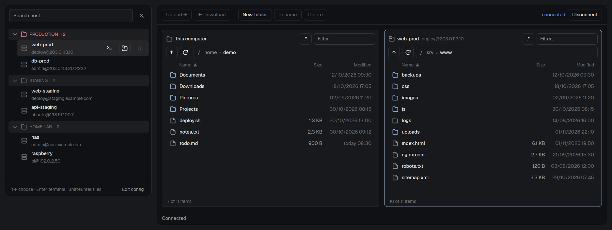

# SSH hosts

An **SSH** row in the sidebar that opens a searchable list of the hosts in your `~/.ssh/config`, grouped by the comments in that file. Each host opens an SSH terminal or a two-pane **SFTP browser** (this computer on the left, the server on the right, FileZilla style) with a transfer queue. Passwords and host-key fingerprints are asked in a dialog of the mod's own.



## What you see

**The sidebar row.** A block 32 px high (fixed: `min` and `max` are 32 too) with, left to right: a terminal icon, the word `SSH`, the number of hosts (10 px, dimmed, filling the free space), and a right chevron. Text is 12 px, on the theme's `chrome` background; on hover the background becomes `hover` and the text `foreground`.

**The picker popup** (click the row). 360 px wide; its height fits its content, never less than 220 px or more than 560 px. Top to bottom:

1. A 52 px bar: a search field (32 px high, placeholder `Search host…`, the cursor already in it) and a 32 px square close button.
2. The list, which scrolls. Sections in this order: **Pinned**, **Recent** (only when there are more than 6 hosts), then one section per group of the file. A group header is 28 px: chevron, folder icon, the name in capitals, ` · N`, on a shaded (`hover`) background; 11 px text, dimmed, **red (`ansi1`) if the name contains "prod"**. Its hosts are indented 16 px with a 1 px vertical line on the left. Pinned and Recent have a plain heading with no icons or fold.
3. Each host row is 40 px: a server icon, the alias, and under it `user@host:port` in 11 px dimmed text (port 22 is not shown). A small `jump` tag with a border appears when the host has `ProxyJump`. A 6 px round green (`done`) dot beside the alias means a terminal or file browser is already open for it. A pinned host shows a ★ on the right.
4. A 36 px footer with a 1 px top border: `↑↓ choose · Enter terminal · Shift+Enter files` on the left and an `Edit config` button on the right.

The hovered or chosen row has the `selected` background and shows three controls on the right: a 28×26 **Terminal** button, a 28×26 **Files** button (both with a 1 px border and a 16 px icon) and a ☆ to pin (★ in the accent color once pinned).

**The SFTP tab**, named `SFTP · <alias>`. Top to bottom:

1. A 48 px toolbar: `Upload →`, `← Download` (they show a count when several items are selected: `Upload 3 →`, `← Download 3`), a 1 px separator, `New folder`, `Rename`, `Delete` (danger style), then a flexible gap, the state text (`connected` in the `done` color, `connecting…` or `not connected` dimmed) and a `Connect` / `Disconnect` / `Reconnect` button (primary style while not connected).
2. Two panes side by side with 12 px padding and a 12 px gap, each: a row of 28 px controls (path as clickable breadcrumbs, ↑, ⟳, a name filter and a `.*` toggle for hidden files), a 22 px column header (Name, Size, Modified, sortable) and a virtual list of 28 px rows (folder or file icon, name, size such as `1.5 MB`, date such as `today 14:05` or `02/11/2026 14:05`). The active pane is marked.
3. A transfer queue at the bottom: a 40 px summary row (files, bytes, speed, time left, with `Cancel all`, `Retry`, `Clear`) that expands into a 170 px list of 26 px rows, one per file, each with its status, a progress bar and a cancel or retry button.
4. Dialogs over a near-opaque canvas (97 %), 440 px wide cards: password or key passphrase (masked field), new host fingerprint, name conflict, new folder, rename, delete, and the read-only file viewer.

All colors come from the active theme (`chrome`, `hover`, `selected`, `border`, `foreground`, `muted`, `dim`, `accent`, `done`, `ansi1`, `popover`, `canvas`, `input`); nothing is hard-coded except the transparent `#00000000` of unselected rows.

## How it behaves

**Reading the hosts.** Only the explicit aliases of `~/.ssh/config` are listed (patterns such as `*` and `Include` files are not). A comment right above a `Host` line, with no blank line between, starts a group named after it (up to 40 characters) that lasts until the next such comment; a comment followed by a blank line (a file header) is not a group. Without any group there are no headings; with groups, hosts outside them go last under `Other`. User, port and ProxyJump shown come from the host's block, falling back to `Host *`; the first value wins, as in OpenSSH. The list reloads by itself when the file changes (a 30 s timer if the folder cannot be watched). If the file is missing the popup says `~/.ssh/config not found` in red; with no hosts, `No aliases in ~/.ssh/config. Add a “Host” block and it will show up here.`; with no match, `No host matches “…”`.

**Picker keys and clicks.** Typing filters by alias, host or user and shows every match in one list. ↑ ↓ move the cursor (wrapping); hovering a row moves it too. `Enter` or a click on the row opens an SSH terminal, `Shift+Enter` or the Files button opens the SFTP browser, `Ctrl+Enter` opens a new terminal even if one exists. `Esc` or the X closes. If a tab for that host is already open (a terminal named after the alias, or `SFTP · alias`) it is selected instead of opening another. Clicking a group header folds it (remembered). The ☆ pins a host. The last 8 hosts used are remembered. Pinned, recent and folded groups are stored in Herdr's shared state under `ssh-hosts.pinned`, `ssh-hosts.recent` and `ssh-hosts.folded`. `Edit config` opens the file with `xdg-open` (Linux), `open -t` (macOS) or `notepad.exe` (Windows).

**The terminal.** Opens a tab named after the alias that runs `ssh -F ~/.ssh/config <alias>` in the active local space, the space named `SSH`, or the first local space; if there is none, a new space `SSH` is created. Any password is typed in that terminal.

**The SFTP browser.**
- Click selects and makes that pane active; `Ctrl+click` toggles; `Shift+click` selects a range; double-click opens a folder or sends a file to the other pane. Keyboard with a list focused: ↑ ↓ PageUp PageDown Home End move (with `Shift`, select); `Enter` opens or sends; `Backspace` goes to the parent and keeps the cursor on the folder you left; `Tab` switches pane; `F3` views a server file; `F5` sends; `F2` rename; `F7` new folder; `Del` delete; `Ctrl+A` select all; `Ctrl+C` copy the paths; `Ctrl+F` filter; `Ctrl+R` refresh; `Ctrl+H` hidden files; `Esc` clears the filter, then the selection, or cancels a dialog. In dialogs `Enter` confirms.
- Right-click opens a menu (view, transfer, rename, delete, new folder, copy paths, refresh, show or hide hidden files). Files and folders can be dragged from the system onto the server pane.
- Sorting by Name uses natural order (`file2` before `file10`). Each pane remembers its sort and hidden-files setting; the last local and remote folder are remembered per host. On Windows the local pane starts at `Computer` with the drives.
- Transfers go through the queue; folders are walked while transferring, so queuing a huge folder is instant. Statuses and their labels: `queued` → `Queued`, `running` → `Transferring`, `conflict` → `Already exists: waiting`, `done` → `Done`, `skipped` → `Skipped`, `failed` → `Failed`, `cancelled` → `Cancelled`. When a file already exists the queue stops and shows size and date of both, with `Skip`, `Rename` (saves as `name (2).ext`) and `Overwrite`, and an option to apply it to the rest. An overwritten server file keeps its permissions; a new one gets `rw-r--r--`. Folders that exist are completed without asking. Links to folders are not followed; links to files are transferred as files. You can keep browsing while it transfers.
- Delete asks first and only removes a file, a link or an **empty** folder. Rename never replaces an existing file.
- The viewer (`F3`) shows a text file from the server read-only with syntax highlighting. Files over 1 MB, binary files and folders are refused with a message.

**Agent statuses.** The mod does not read or show agent statuses (working, blocked, done, idle); the only status it draws is the green "already open" dot.

## Built from

Folder `mods/ssh-hosts/`, which is the whole mod:

| File | Role |
|---|---|
| `mod.json` | `{"place":"none","title":"SSH"}`. `place: none` means copying the folder adds nothing to the window. |
| `main.js` | `SSHHosts` view: the sidebar row, the popup (`props.popup`), the SFTP tab (`props.mode === 'sftp'`). |
| `config.js` | Parses `~/.ssh/config`: `parseConfig`, `groupHosts`, `target`, `launchPlan`. |
| `sftp.js` | `SftpPanel`: the whole SFTP view. |
| `sftp_bridge.py` | Python 3 helper (standard library only): the SSH/SFTP connection, local listings, transfers, the loopback HTTP API. |
| `askpass.sh`, `askpass.cmd`, `askpass.py` | `SSH_ASKPASS` programs that hand OpenSSH's questions to the tab. |
| `*.svg` | 16 px icons, drawn with `svg('mods/ssh-hosts/<name>.svg')`: `terminal`, `server`, `sftp`, `folder`, `file`, `chevron-down`, `chevron-right`, `close`, `refresh`. |
| `jsconfig.json`, `README.md` | Editor settings and the mod's documentation. |

**Layout.** There is no layout file. The person adds this block to a layout of their own (the shipped ones are read-only, so clone one first with `herdr-app do layout.clone '{"name":"main","as":"my-layout"}'`), for example in the `sidebar` column above `sidebar-lists`:

```json
{ "id": "ssh-hosts", "type": "block", "content": { "mod": "ssh-hosts" }, "size": { "px": 32 }, "min": 32, "max": 32 }
```

**Imports.** From `gpui-kit`: `View`, `div`, `svg`. From `gpui-base`: `v_flex`, `h_flex`, `Input`, `InputState`, `Editor`, `EditorState`, `Scrollbar`, `v_virtual_list`, `VirtualListScrollHandle`. From `herdr`: `exec`, `home`, `appHome`, `readTextFile`, `spaces`, `run`, `theme`, `props`, `openOverlay`, `closeOverlay`, `shared`, `setShared`, `settings`, `watchFolder`, `window`.

**Commands it runs:** `tab.new` (`{space, name, argv}` for a terminal; `{space, name: 'SFTP · alias', mod: 'ssh-hosts', props: {mode: 'sftp', alias, target}}` for the browser), `space.new` (`{machine: '', name: 'SSH', tab: alias, argv}`), `space.select`, `tab.select`. The popup is `openOverlay({ mod: 'ssh-hosts', props: { popup: true, height }, kind: 'popup', width: 360, height })`: a popup takes its content's size, so the height is computed from the list (`52 + 44 + headings × 34 + rows × 40 + 16`, clamped to 220–560) and passed as a prop.

**Programs it runs:** `ssh` (OpenSSH, on the PATH) and `python3` (`python` on Windows). The bridge starts `ssh -F <config> -T -o StrictHostKeyChecking=ask -o ConnectTimeout=20 -o ServerAliveInterval=15 <alias>` with the `sftp` subsystem, and sets `SSH_ASKPASS` and `SSH_ASKPASS_REQUIRE=force`. Host-key checking is never turned off. The view calls the helper with `exec(python, [helper, 'start', alias, config, start])` and then talks to it with `fetch` over HTTP on `127.0.0.1` (random port, random key that is never written to disk): `POST /rpc` runs an action and a long-poll on `/events` delivers progress and listings with no timers. `xdg-open`, `open` or `notepad.exe` open the config.

**Files it touches outside its folder:** reads `~/.ssh/config`; the SFTP browser reads and writes any local folder the person browses; transfers create `.herdr-upload-*` and `.herdr-download-*` temporaries next to their targets. It reaches the network only through `ssh`, to the servers the person picks.

## Watch out

- **Nothing shows until the block is in a layout.** `place: none` is deliberate. Do not edit a shipped layout; it is replaced on every start.
- **The row must stay 32 px.** The popup is opened from it and sized from the hosts, not from the row. A popup takes its content's size, so a list with only a flexible height would collapse: the height must be passed in `props`.
- **Hosts are informational.** User, port and jump shown are read by `config.js`; OpenSSH resolves the real connection. `Include` files, `Match` blocks and wildcard aliases are not listed. A `Host` with several aliases lists each one. Aliases must match `^[a-zA-Z0-9][a-zA-Z0-9._-]*$`; anything else is skipped (this also keeps the alias safe as an argument).
- **Group names** are comments directly above `Host` (no blank line) and at most 40 characters; a longer one is ignored. A group with "prod" in its name is red, any case.
- **Limits:** 20,000 entries per folder listing, the viewer reads up to 1 MB, 64 requests of 32 KB in flight per transfer (like OpenSSH's `sftp`), the recent list keeps 8 hosts and shows 4. The helper exits on `Disconnect`, when the tab closes, or after 90 s without the tab; a forced close or a lost connection can leave an unfinished `.herdr-upload-*` or `.herdr-download-*` behind.
- **Never store or log a password.** It goes from the masked field to OpenSSH through the askpass program and nowhere else, not into a file, an argument or the shared state.
- **State lives in shared state, not `localStorage`** (which does not last across popups and restarts).
- **No `keys.json`.** The mod binds no global keys; every key above works only with its popup or list focused.
- **Python must be Python 3** with its standard library; `-I` (isolated mode) is used for the askpass program so a stray file next to it is never imported.
- Do not add real servers, users or addresses to the repository or the screenshots. `preview.png` was made in an isolated Herdr (dark `graphite` theme) with an invented `~/.ssh/config` (documentation addresses `203.0.113.0/24`, `198.51.100.0/24`, `192.0.2.0/24` and `example.com`), a made-up home folder (`/home/demo`) and made-up server files (`/srv/www`).
- `preview.png` shows two blocks side by side so nothing hides anything: the picker popup on the left (360 px, the same view the sidebar row opens) and the SFTP tab on the right. A screenshot cannot click the row, so the popup is drawn as a block with `props: { popup: true, height: 470 }`; the real one opens over the window.
- The SFTP half of the preview is connected through a stand-in `ssh` that runs the local OpenSSH `sftp-server`, not through a real server.

## Done when

1. `herdr-app check mods/ssh-hosts` passes, and the app writes no `.error` file for the layout.
2. With the block added to a cloned layout, the sidebar shows an `SSH` row 32 px high with the right host count, and clicking it opens a 360 px popup with the search field focused.
3. A `~/.ssh/config` with `# Production` above `Host web-prod`, `# Staging` above `Host web-staging` and a blank line after a file-header comment shows two groups, `PRODUCTION` in red and `STAGING` in the dim color, and no group for the header comment.
4. Typing part of a user, host or alias narrows the list to the matches in a single list, and a text with no match shows `No host matches “…”`.
5. `Enter` opens a tab named after the alias running `ssh -F <config> <alias>`; choosing the same host again goes to that tab (a green dot is shown) and `Ctrl+Enter` opens a second one.
6. `Shift+Enter` opens `SFTP · <alias>`; with a local `sshd` the browser connects, asks for the password in its own dialog when needed, and shows `connected`.
7. Uploading and downloading files and a folder works, the queue shows every row with its status, and sending a name that already exists stops with `Skip` / `Rename` / `Overwrite`.
8. `F3` on a text file shows it read-only; on a file over 1 MB it is refused with a message.
9. Saving `~/.ssh/config` with a new host updates the open popup without reopening it.
